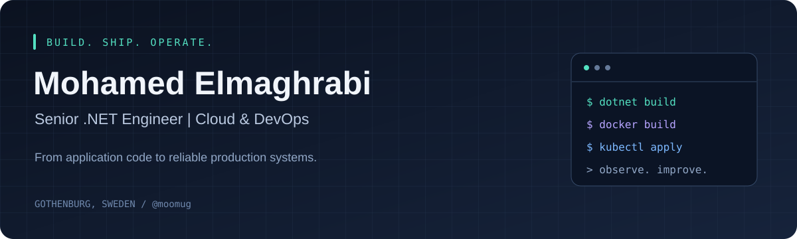
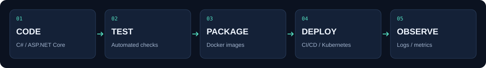

  

  
  
  

## The engineer behind the code

I'm **Mohamed**, a Senior .NET Engineer based in **Gothenburg, Sweden**, expanding my focus into **DevOps and platform engineering**.

Since 2018, I've worked on business applications, backend APIs, payments, and enterprise platforms. Today, I connect that application engineering experience with hands-on work in Linux, containers, Kubernetes, and automated delivery.

- **My foundation:** C#, ASP.NET Core, Clean Architecture, CQRS, and distributed systems.
- **My current work:** .NET integration and production platform engineering at ANYO Labs.
- **My direction:** services that are easier to deploy, observe, troubleshoot, and recover.

> Good engineering continues after the code is merged.

## From development to production

## My toolbox

**Application engineering**

**Cloud & platform**

**Delivery, data & observability**

## On my workbench

Public projects and learning work, with their current scope.

| Project | What you'll find |
| :--- | :--- |
| **[Order & Payments](https://github.com/moomug/OrderAndPayments)** | ASP.NET Core order and payment APIs, data access, and Dockerfiles. |
| **[AEams](https://github.com/moomug/AEamsify-master)** | ASP.NET Core MVC application with attendance, departments, schedules, and Identity account flows. |
| **[Bloodify](https://github.com/moomug/Bloodify)** | ASP.NET web application with Identity-based account management. |
| **[Bidding App](https://github.com/moomug/biddingApp)** | An auction backend in its early development stage. |
| **[Personal Portfolio](https://github.com/moomug/my-portfolio)** | My professional background, presented with Next.js and TypeScript. |

## Experience beyond public repositories

| Team / engagement | Focus |
| :--- | :--- |
| **ANYO Labs** | .NET integration, Linux and Kubernetes operations, production troubleshooting, and operational documentation. |
| **Where Is** | Commercial directory backend, caching, digital-wallet integrations, e-invoicing, and cloud infrastructure. |
| **Moqla / Taif University** | .NET backend systems and enterprise digital transformation. |
| **ALAM NAMAA & Mea-Tech** | Full-stack .NET applications and university workflows. |

## Building next

I'm growing my public portfolio around the complete delivery lifecycle: a .NET service, container builds, CI checks, infrastructure as code, deployment documentation, and a practical rollback runbook.

---

  <b>Let's talk about .NET, cloud, and reliable platforms.</b> 
  Open to .NET backend, DevOps, and platform engineering opportunities in Sweden.  
  <a href="https://www.linkedin.com/in/mohamed-elmaghrabi/">LinkedIn</a> &nbsp; / &nbsp;
  <a href="https://elmaghrabi.vercel.app">Portfolio</a> &nbsp; / &nbsp;
  <a href="mailto:moghrabi.eng@gmail.com">Email</a>

